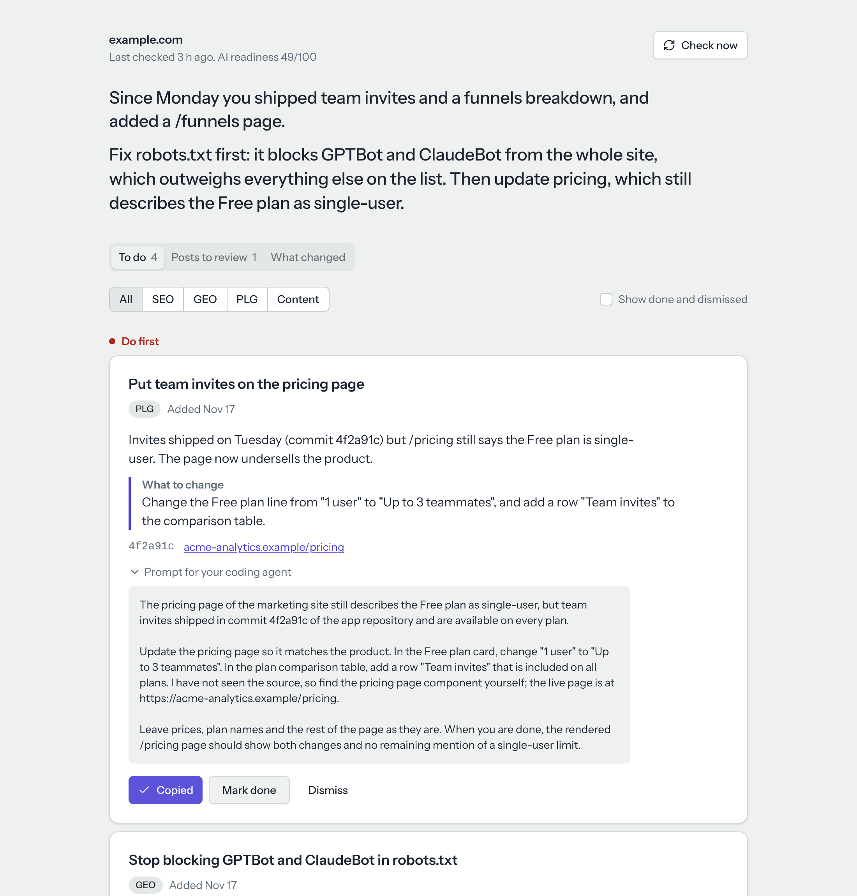

# AI CMO

A self-hosted marketing agent for a product you build and change often. It does two jobs:

1. **Watches your site and your commits**, and on a schedule tells you what to do next for search (SEO), AI answer engines (GEO) and product-led growth (PLG).
2. **Plans and writes social posts**, from a brief or from a feature it saw you ship, and puts them in a review queue. A person approves each post before it is sent to [Postiz](https://github.com/gitroomhq/postiz-app) for publishing.

Both land in one local interface, the growth desk.



```
your site ──audit tools──┐
your site ──page diff────┼──> Claude agent ──> recommendations ──> you: done / dismiss (with a reason)
your repos ──git log─────┘         │      (each with a prompt for your coding agent)
                                   └────────> post drafts ──────> you: approve ──> Postiz ──> channels
```

## Design

- **The agent cannot publish.** Its tools read channels, load skills and save drafts. Sending a post to Postiz happens only in `cmo approve`, which a person runs.
- **One agent, many skills.** Channel and task expertise lives in `SKILL.md` playbooks the agent loads on demand, not in separate agents. Two are included; `npm run skills:install` adds the MIT-licensed [marketingskills](https://github.com/coreyhaines31/marketingskills) set (copywriting, SEO, CRO, email, ads and more).
- **Postiz stays a separate service.** This project talks to its public HTTP API only. Postiz is AGPL-3.0; none of its code is included or linked here.
- **Rejections are feedback.** Rejecting a post or dismissing a recommendation stores your reason, and the agent reads it before its next run.
- **Existing tools measure, the agent judges.** SEO and GEO rules are not implemented here. Each check runs external audit tools and gives their reports to the agent, which decides what matters for this product, reads pages where it needs to, and writes the fix. What this project adds is the part those tools lack: tying site changes to your commits, the PLG view, one prioritized list, and a prompt per item.
- **Local and single-user.** The interface listens on `127.0.0.1` only, and accepts writes only from its own page.

## Setup

Requires Node 20+.

```bash
npm install
cp .env.example .env                 # add ANTHROPIC_API_KEY; POSTIZ_API_KEY is optional
cp brand.example.json brand.json     # describe your brand, audience and voice
cp watch.example.json watch.json     # your site URL and the local paths of your app repos
npm run build:ui                     # build the interface (once, and after changing web/)
npm run skills:install               # optional: more marketing skills
```

Without a Postiz key the agent still plans and drafts by platform name; you need the key to list channels and to approve.

## Use

### Watch the site and the product

```bash
npm run cmo -- ui --every 24         # open http://localhost:4321 and check once a day
npm run cmo -- review                # or run one check now from the terminal
npm run cmo -- todo                  # list open recommendations
npm run cmo -- prompt a1b2c3         # print a recommendation's prompt for a coding agent
```

`watch.json` names the site, the git clones to read commits from, and the audit tools to run:

```json
{
  "site": { "url": "https://example.com", "maxPages": 30 },
  "repos": [{ "name": "app", "path": "../my-app" }],
  "sources": [
    { "type": "geo-optimizer", "maxPages": 10 },
    { "type": "command", "name": "AI visibility (Canonry)", "command": ["cnry", "visibility-stats", "my-site", "--format", "json"] }
  ]
}
```

| Source | What it adds | Needs |
|---|---|---|
| `geo-optimizer` | [GEO Optimizer](https://github.com/Auriti-Labs/geo-optimizer-skill) (MIT): a 0-100 AI-readiness score with checks for crawler access, `llms.txt`, structured data, meta tags and content. It audits public URLs only. | [`uv`](https://docs.astral.sh/uv/) on PATH (runs it with `uvx`, nothing to install), or `pip install geo-optimizer-skill` and `"command": ["geo"]` |
| `command` | Any tool that prints a report. The example reads AI-visibility figures from [Canonry](https://github.com/Canonry/canonry) (MIT): whether ChatGPT, Claude or Gemini mention and cite you for the queries you track. | The tool installed and set up; Canonry needs its own server running and your own provider keys |

Commands run without a shell, with the words exactly as listed. A tool that is missing or fails is reported under "What changed" and the check continues without it.

Each check runs the audit tools, takes a snapshot of the site's pages (sitemap first, links otherwise) and compares it with the previous one, reads the commits made since, and saves at most eight recommendations, each with the reason, the concrete change and the evidence. Each recommendation that needs a code or content change also carries a self-contained prompt for a coding agent: copy it from the interface with "Copy prompt", or pipe it, for example `npm run -s cmo -- prompt a1b2c3 | claude`. The first check treats the whole site as new. `ui --every` keeps the process running; to schedule without it, run `npm run cmo -- review` from cron.

"PLG 2.0" and "PLG 3.0" have no single agreed definition. `skills/plg-review/SKILL.md` states the one used here (product-led with sales and lifecycle assistance; AI-native products that are also usable by agents); edit it to match yours.

### Posts

```bash
npm run cmo -- plan "One week of LinkedIn posts for the Funnels launch, 3 posts"
npm run cmo -- drafts pending
npm run cmo -- show a1b2c3
npm run cmo -- approve a1b2c3                  # schedule at the draft's time
npm run cmo -- approve a1b2c3 --now            # publish immediately
npm run cmo -- approve a1b2c3 --at 2026-12-01T09:00:00+03:00 --channel <id>
npm run cmo -- reject a1b2c3 "Too salesy, lead with the customer result"
npm run cmo -- channels
npm run cmo -- skills
```

Approving and rejecting also work from the interface.

## Configuration

| Variable | Default | Purpose |
|---|---|---|
| `ANTHROPIC_API_KEY` | | Claude API key |
| `POSTIZ_API_URL` | `https://api.postiz.com/public/v1` | Postiz public API; for self-hosted use `https://<backend>/public/v1` |
| `POSTIZ_API_KEY` | | Postiz API key, from your Postiz settings |
| `CMO_MODEL` | `claude-opus-5-5` | Model for the agent |
| `CMO_EFFORT` | `high` | `low` to `max`; lower is faster and cheaper |
| `CMO_WEB_SEARCH` | on | Set `0` to disable web research |
| `CMO_UI_PORT` | `4321` | Port of the local interface |
| `CMO_BRAND_FILE`, `CMO_WATCH_FILE`, `CMO_SKILLS_DIR`, `CMO_DATA_DIR` | `brand.json`, `watch.json`, `skills/`, `data/` | File locations |

## Layout

| Path | What it holds |
|---|---|
| `src/agent.ts` | Post-planning prompt and tools, the tool-runner loop |
| `src/review.ts` | The site and product review: inputs, prompt, tools, run record |
| `src/sources.ts` | Runs the external audit tools and collects their reports |
| `src/site.ts` | Page snapshot and diff, for change tracking |
| `src/repo.ts` | Recent commits from a local git clone |
| `src/recommendations.ts` | Recommendation list (JSON file) |
| `src/ui.ts` | Local server: the JSON API and the built interface |
| `web/` | The interface: React, Vite, Tailwind and [shadcn/ui](https://ui.shadcn.com) components (`web/src/components/ui`) |
| `src/publish.ts` | Approve and reject: the only path from a draft to Postiz |
| `src/postiz.ts` | Postiz public API client |
| `src/drafts.ts` | Review queue (JSON file) |
| `src/skills.ts`, `skills/` | Skill discovery and the included playbooks |
| `src/brand.ts` | Brand file schema |
| `src/cli.ts` | Command line |

## Working on the interface

`web/` is its own package. The components in `web/src/components/ui` are shadcn/ui sources (MIT) copied into the project, so they are yours to edit; `web/components.json` is set up for `npx shadcn@latest add <component>`. The theme lives in `web/src/index.css`.

```bash
npm run cmo -- ui                    # the API on :4321
npm --prefix web run dev             # the interface with hot reload, proxying /api to :4321
```

## Tests

```bash
npm test          # runs against local fake Postiz and Claude API servers; no keys needed
npm run typecheck
```

## Limits

- Out of the box the review sees the public site, the GEO audit and commit messages: no analytics, no Search Console, no logged-in product. Canonry can supply Search Console and AI-visibility data as a `command` source, but that path has only been tested with a stand-in command, not a configured Canonry instance.
- There is no dedicated technical-SEO crawler (broken links, redirect chains). SEOnaut was considered and left out: it is a web application that needs MySQL and Docker and has no command-line or API output to read.
- The page snapshot is taken without running JavaScript, so content rendered only in the browser is not seen. That is also how most AI crawlers see the site.
- Text posts only; no images or video yet.
- Everything is stored in local JSON files, for one user on one machine.
- Some Postiz providers require settings (for example who can reply on X). The agent reads the schema from Postiz and fills them in, and Postiz validates them on approve.
